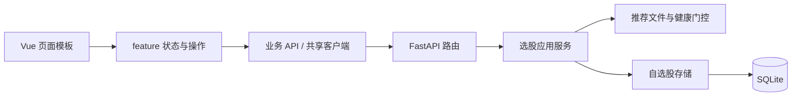

# StockPilot 单人版代码地图

本项目继续使用 Vue 3 + FastAPI + Python 策略 + SQLite。以个人工具为目标，浏览器界面、业务服务和数据库各自有清楚的检查入口。

## 先看哪些文件

| 你想检查或修改什么 | 首选入口 | 职责 |
| --- | --- | --- |
| 选股页面结构、按钮、列 | `frontend/src/views/SignalsView.vue` | 模板、组件绑定、页面对外刷新接口 |
| 选股筛选、搜索、分页、自选股交互 | `frontend/src/features/signals/useSignalsPage.js` | 每个页面实例独立的状态和操作 |
| 鼠标拖拽、点击抑制和事件清理 | `frontend/src/features/signals/useTableDrag.js` | 表格指针交互 |
| 推演页面结构、操作面板 | `frontend/src/views/PaperTradingView.vue` | 模板和组件绑定 |
| 推演步进、播放、重置、快进 | `frontend/src/features/sandbox/useSandboxPage.js` | 串行操作队列、播放定时器、页面生命周期 |
| 收益曲线与方案对比的显示内容 | `frontend/src/features/sandbox/chartOptions.js` | 根据已有数据生成 ECharts 选项 |
| 图表创建、尺寸更新和资源释放 | `frontend/src/features/sandbox/useSandboxCharts.js` | 每个页面实例拥有自己的图表 |
| 选股或推演页面样式 | 两个 feature 目录下的 `styles/` | 按工具栏/筛选/表格、方案/播放/结果划分；保持 scoped |
| 某项前端接口的路径、参数 | `frontend/src/api/{业务名}.js` | signals、market、holdings、paper、recap、settings、sandbox |
| 请求公共配置 | `frontend/src/api/client.js` | 唯一 Axios 客户端；`/api`、15 秒超时 |
| 实时连接与重连 | `frontend/src/api/websocket.js` | WebSocket、心跳与关闭时取消重连 |
| 选股 HTTP 参数与响应入口 | `api/routers/signals.py` | HTTP 路由；不直接执行 SQL 或读取 CSV |
| 服务端选股筛选、统计、自选股合并 | `services/signals.py` | 无 FastAPI 类型的业务服务，显式接收配置 |
| 推荐文件、价格分档、评分说明 | `services/recommendations.py` | 数据健康门控、读取 CSV、生成展示字段 |
| 自选股 SQLite 读写 | `data/watchlist.py` | SQL、事务、连接关闭；复用原有表 |

`frontend/src/api.js` 保留兼容导出；已有组件继续导入 `api` 和 `createWebSocket`。新代码可以从对应业务 API 模块导入，但 HTTP 路径保持一致。

## 数据流



## 检查约定

1. 页面文件负责布局和绑定；状态、请求、定时器放在本业务 feature。composable 每次调用创建新状态，不能把个人选择放进模块级变量。
2. HTTP 路由负责 Query 参数及 HTTP 契约；服务负责筛选、组合与计算；数据库访问放在 data 模块中。
3. 业务服务显式接收 `Settings`，一次请求使用同一份配置快照。推荐数据的健康门控必须在读取前执行。
4. 推演的步进、重置和快进继续走同一串行队列。关闭页面需要暂停播放、移除事件并释放图表。
5. 已有行情缺失、阻断、未定义指标的显示语义继续保留；图表配置不产生收益数据。
6. 按职责拆文件，不按固定行数机械切割。当前页面模板约 400–500 行；业务逻辑文件约 40–280 行。

## 运行和验证

从项目根目录运行后端：

```bash
./run.sh
.venv/bin/python -m pytest -q
.venv/bin/python -m pytest tests/test_signal_services.py tests/test_unified_risk.py -q
```

前端：

```bash
cd frontend
npm test
npm run build
```

项目根目录的 `conftest.py` 会把每个后端测试切换到临时目录，并禁止真实通知发送，保护实际行情库、配置和账本。前端测试用真实生产 composable，替换外部 HTTP、图表设备接口和时钟，不替换筛选或队列逻辑。

## 后续维护边界

本轮完成选股链路与两个最大页面的分离。盘中 API、模拟账户策略、历史沙盒、复盘页面等仍沿用原结构；维护这些模块时再沿相同边界拆分。复盘任务目前仍是进程内任务注册表，重启持久化属于单独的功能改动，本轮未实现。前端仍有大包警告，后续按页面做懒加载时需要单独验证加载与刷新行为。
