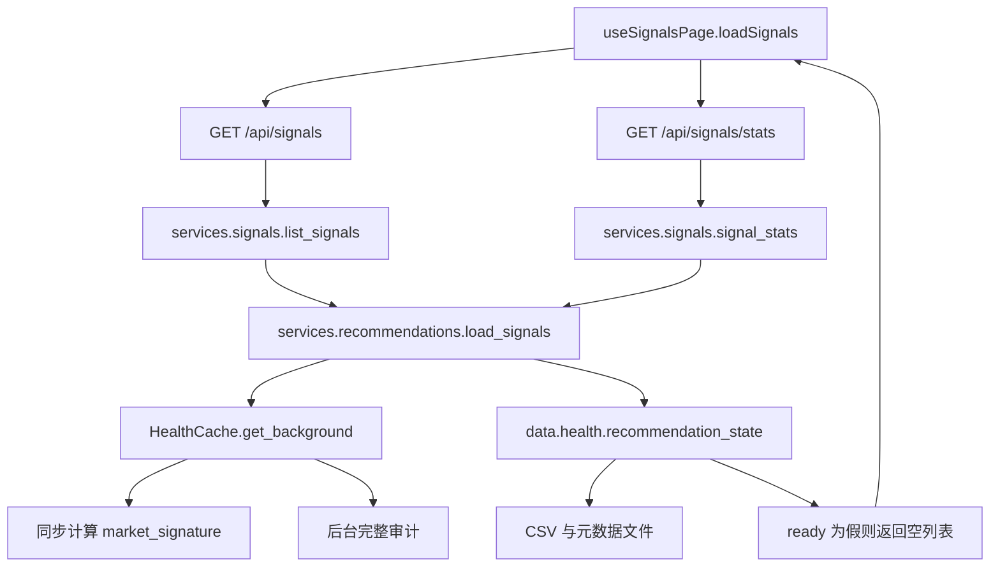

# 工作包 A：故障基线、显示状态、接口契约与验收设计

日期：2026-10-12（Asia/Shanghai）。范围：调查、诊断测量与方案；未实施工作包 B/C。调查对象：本仓库 `stock-pilot`，基准提交见 `baseline-evidence.json`。本文件中的“必须”是后续实现要求，不代表现系统已满足。

## 1. 结论与设计选择

结果展示、后台工作、当前操作权限分别建模。已发布结果即使过期、正在重新核验或新任务失败，也保留为有时间标识的历史内容；显示不等于允许买入。确证内容损坏或来源撤销时，该版本被撤销，退出候选列表，保留原因和版本信息。

推荐采用**独立 SQLite 结果库 + 单次页面响应**。原因是已有 SQLite 技术栈，结果、统计、元数据、发布指针及撤销记录可在同一事务内一致读取；行情更新不会让页面扫描行情库。备选方案：版本目录与原子 manifest 切换，改动小但撤销、任务恢复和并发指针需要额外协议；在现有行情库加入结果表，事务方便但更易受大型行情写入竞争影响。工作包 B 采用第一种，结果库位于 `artifacts/results.db`，不改变预测账本的冻结语义。

## 2. 已确认的调用链与故障机制

| 证据位置 | 现行为 | 影响 |
|---|---|---|
| `api/health_cache.py: get_background/get` | 缓存过期、锁竞争或签名变化时返回 `ready=False`；失败删除原缓存；进程内缓存 | 核验状态与结果显示资格混在一起；重启首读处于未核验状态 |
| `api/health_cache.py: market_signature` | 请求同步计算签名；旧库扫描 bars/minute_bars；新库仍读取快照和来源批次集合 | “后台审计”不等于请求路径完全轻量，签名也必须移出页面请求 |
| `services/recommendations.py: load_signals` | 未 ready 返回 `[]`；异常 CSV 也返回空表；有效行按价格/得分过滤 | 无结果、读损坏、核验中与真实为空不能区分 |
| `services/signals.py` 与 `api/routers/signals.py` | 列表、统计各自读取；没有 snapshot_id；统计内部共享一次 health | 单个统计响应内部已有改善，两个响应之间仍不一致 |
| `frontend/src/features/signals/useSignalsPage.js: loadSignals` | Promise.all 两个请求；成功得到空数组就覆盖旧列表；统计失败用零值兜底 | 空屏或假零统计；旧列表存在时错误信息不一定可见 |
| `frontend/src/views/SignalsView.vue` | statusMessage 主要显示在空行中；刷新按钮由 loading 控制 | 更新与网络读取状态混合；有列表时不能稳定呈现错误 |
| `scripts/daily_update.py: run_daily` | 审计通过后先 unlink 元数据，再算特征；顺序覆写 scores、recommendations、orders，最后替换元数据 | 计算失败或重启可留下旧 CSV 无元数据、部分新文件；元数据原子替换不等于整批原子发布 |
| `data/health.py: recommendation_state` | 日期必须与当前行情一致；空 CSV 判为未就绪 | 历史显示被阻断；正常为空无独立状态 |
| `api/jobs.py: DailyJobRegistry` | queued/running/succeeded/failed；内存任务；无阶段、started_at、持久化或 interrupted | 重启无法解释之前任务；没有真实进度证据 |
| `strategy/sizing.py: compute_plan` | 防御模式保留排名，建议仓位/金额归零 | 引擎已有保留排名能力，接口和页面需要明确传递限制 |
| `strategy/decision.py: decide` | 排名后按 max_positions 与持仓截取；预测账本冻结 payload | 全量候选与最终计划不同，不能把截取后的计划当全市场候选 |

跨边界消费者还包括 `api/routers/status.py`、`holdings.py`、`orders.py`、`paper.py`、`intraday.py`。B/C 必须逐个检查这些读取入口，不能只改选股页面而让操作接口继续消费可变 CSV。

## 3. 故障复现与测量边界

可复运行：从仓库根目录执行 `.venv/bin/python docs/work-package-a-20261012/baseline_probe.py`。诊断脚本仅使用临时结果目录、独立任务注册器、受控核验函数及只读真实行情库；不启动应用 lifespan、不更新行情、不训练、不通知。

固定时间为 `2026-10-12T10:00:00+08:00`，结果交易日 `2026-10-09`；5 个固定代码，价格 10/20/50/100/101，覆盖分档边界；样本摘要记录在证据 JSON。TTL 时钟从 0 推进至 121 秒。长任务用 Event 阻塞，释放时机由诊断控制，避免依赖机器速度。原系统仍用真实 elapsed time 测查询，业务时间由替身控制。

| ID | 重现步骤 | 当前证据/判定 | 后续验证 |
|---|---|---|---|
| F01 首次无结果 | 空临时目录 + 已通过核验 health，请求 stats | 提示缺少推荐文件；GET 不提交初始化生成任务；冷缓存另测 | 无结果、明确初始化入口，job/原因可见 |
| F02 过期核验 | 发布5行样本，缓存时钟推进121秒，阻塞审计，再查 list/stats | 列表和数量归零，audit_pending 为真 | 保留同版本5行，权限独立暂停 |
| F03 更新中 | 实例任务运行后不释放；另删除临时元数据模拟生产 run_daily 的删除窗口 | job 只有 running；结果因缺元数据未就绪 | 列表稳定；展示阶段与更新时间 |
| F04 更新/源失败 | 受控任务抛异常；受控审计抛异常 | job failed 有 error；审计失败清缓存；CSV仍存但显示受门禁影响 | 显示旧时间+失败原因；损坏另判撤销 |
| F05 服务重启 | 新 HealthCache 和新 DailyJobRegistry；结果文件保留 | 首读未核验；旧job不可恢复 | 从结果库读旧版本；遗留job标中断 |
| F06 禁止新买入 | compute_plan 传 allow_new_buy=False | 5行排名保留、建议权重全0；当前页面读取器未暴露明确权限 | 显示排名、禁止买入、原因贯穿操作接口 |
| F07 正常为空 | 带列头的0行CSV + 同日元数据 + ready health | recommendation_state ready=False，“当前交易日没有可用推荐” | current+empty_kind=screened_out，漏斗解释为空 |

这些是隔离诊断和源码证据。未运行真实数分钟训练、未断开真实行情源、未重启用户正在使用的服务，未做浏览器截图或 DOM 验证；页面表现由 Vue 逻辑推导。对应端到端验收方法在第8节，不能把诊断替身耗时当真实训练耗时。实际性能数字见 `baseline.md` 和原始 JSON。

## 4. 状态规则与转换

### 4.1 结果状态

| 值 | 中文 | 判定及显示 |
|---|---|---|
| `none` | 无结果 | 从未发布有效版本；snapshot_id/data_as_of/generated_at 为 null，rows=[]，counts 为0 |
| `current` | 当前有效 | 已发布、未撤销、版本匹配、仍处于已认证有效期；允许 rows=[]，空结果也是成功结果 |
| `historical` | 历史结果 | 版本内容有可验证发布证据，但数据时点过期、配置改变、恢复后待确认或核验状态不能支持当前使用；带日期显示，仅供回看 |
| `revoked` | 已撤销 | 确证损坏、来源撤销或人工撤销；返回版本/原因，rows=[]，counts=0；不自动回退到另一版以掩盖撤销 |

审计 TTL 到期本身不证明已发布内容错误。若上次认证仍覆盖同一数据/策略/参数版本且有效期未到，可以保持 current；若不能确定，降为 historical，暂停依赖它的操作。审计传输错误只改变 audit_state/job；确证完整性失效才撤销。禁止用缓存中的旧 ready=True 覆盖撤销。

日线 `valid_until` 在发布时由已有交易日历与 `_expected_session` 的16:10规则计算，使用带时区的绝对时间；交易日历未验证时不赋当前操作资格。页面GET只比较已保存时间和轻量版本令牌，不调用交易日全扫描。盘中因子必须另存更短的认证有效期和行情时点，不能套用日线截止规则；本轮B优先日线，盘中在C独立验收。参数变化使旧结果 historical；取消风险限制不会令过期结果自动 current。历史转 current 仅允许新审计证书重新确认该不可变版本且有效期覆盖现在。

### 4.2 核验、任务与权限

核验 `audit_state`: `unknown/pending/running/passed/failed`；核验针对 `data_version`，保存 checked_at/有效期/原因，不作为列表开关。`failed` 既可能是执行失败也可能是核验拒绝，必须用原因码区分，后者涉及已发布输入时触发撤销。

任务 `job.status`: `idle/queued/running/succeeded/failed/interrupted`。转换：idle→queued→running→succeeded或failed；重启遗留queued/running→interrupted。同一任务终态不可改回running；重试产生新job_id，关联原任务。同一次请求重试复用活跃任务，`data_only`与生成任务的意图不能被无提示混同。没有活跃任务时 job 仍返回最近任务终态；从未运行返回 idle。

阶段 `job.stage`: `queued/fetch/audit/features/train/score/risk/validate/persist/publish/complete`，idle用null。按实际开始阶段写入，不伪造完成百分比；失败保留失败阶段。`started_at/finished_at/heartbeat_at` 缺值用null；error={code,message,retryable} 或null。

操作 `action_permissions`: `view_candidates/create_buy/add_position/export_orders` 各自为 `allowed/paused/forbidden`。导出是导出可执行指令单；历史候选可通过独立回看功能查看，不能混同。自选增删、查看持仓、减仓/卖出沿用各自流程，不因禁止新增买入而一律禁用。

| 组合 | 页面 | 新买入/加仓/可执行导出 |
|---|---|---|
| current + 后台生成中，认证仍有效 | 保留日期及“更新中” | 仅在当前行情、账户及风险再次核验后allowed；未知则paused |
| historical + 生成/核验中 | 保留排名，“历史结果，仅供回看” | paused |
| current + 最新更新失败，旧证书仍有效 | 保留结果日期及失败原因 | 只暂停依赖新结果的操作；原认证及当前风险都通过的操作仍可allowed |
| 历史结果 + 最新任务失败 | 保留数据截止时间、生成时间及常驻错误栏 | paused；failed不会清空结果 |
| none + idle/queued/running/failed | 初始化入口、阶段、失败解释 | paused |
| revoked + 任意任务 | 撤销横幅/原因；无可操作候选 | forbidden |
| current + 风险禁止新买入 | 保留候选；说明限制，不把候选标成买入建议 | create_buy/add_position forbidden；export_orders paused至独立指令校验 |
| current + 正常筛选为空 | 条件及漏斗，明确计算成功 | paused（没有可用候选） |

优先级：撤销 > 明确风险禁止 > 证据未知或过期暂停 > 全部条件通过允许。后台任务运行本身不撤销结果。blocked_reasons 是结构化数组，每项 {code,message,actions}；paused或forbidden的每个操作必须有原因，allowed不得带矛盾原因。网页按钮遵从服务端权限；实际操作接口必须接收 snapshot_id 并重新检查，不信任浏览器先前拿到的 allowed。

## 5. 单次响应接口契约

新增 `GET /api/signals/snapshot`，版本号 `schema_version=1`；保留旧list/stats端点用于兼容迁移。新页只用新端点，不能混拼新旧响应。旧端点直到消费者清单迁移完成才退役。新增具体路由时注意放在未来可能引入的 `/{code}` 参数路由之前。

保留筛选 bracket/min_price/max_price/sort_by/codes；新增q搜索；无分页，默认返回该版本全部候选，现有前端本地分页。未知枚举、负价格、min>max、非法代码返回422，不静默放宽条件。分档：low≤20；mid (20,50]；high (50,100]；top>100；price必须有限且>0。默认得分降序，同分按code升序。

| 字段 | 类型/语义 |
|---|---|
| schema_version | 固定整数1 |
| snapshot_id | string或null；不可变结果标识，不等同trade_date |
| data_as_of / generated_at | 带时区RFC3339或null；数据截止与生成时间不能混用 |
| versions | {data,strategy,parameters} 字符串或null；策略版本含模型/公式身份，参数版本含冻结参数摘要 |
| rows | 数组；每行至少code/name/price/score_blend/price_bracket/rank；既有UI的hand_cost、score_lgb、score_linear、why_recommended等由B适配器保留 |
| counts | {snapshot_total,filtered_total,brackets:{low,mid,high,top}}；同一版全部候选与此次筛选数量；分档统计为筛选后集合 |
| result_state / audit_state | 第4节枚举 |
| audit | {data_version,checked_at,valid_until,error}；认证信息；无证书时null字段 |
| job | 上节完整任务对象；failed/interrupted有error；idle无job_id |
| action_permissions / blocked_reasons | 上节定义 |
| empty_kind | null 或 no_snapshot/screened_out/filter_no_match/revoked；读取失败不是筛选为空 |
| selection | {filters,funnel}；funnel顺序环节{name,input,output,excluded_by_reason}，由生成流程真实记录；已有旧文件没有漏斗时[]，提示“旧版本未记录筛选明细”，不编造数量 |
| response_revision | 结果库的单调递增读取状态版本；发布、撤销、认证、任务或风险变动事务提交时递增 |

counts.filtered_total == len(rows)；sum(brackets.values()) == filtered_total；snapshot_total >= filtered_total；rows/rank/versions/timestamps/selection.funnel来自同一不可变版本。rank是原候选全局排名，筛选后不重新伪装成原榜排名。revoked返空列表统计但保留该版时点及版本。current且rows为空时，用snapshot_total区分生成筛空与页面过滤无匹配。

风险权限允许比结果更新：在同一结果库读事务中获取轻量风险投影及policy版本；投影过期或尚未同步暂停相关操作。GET读取的是一致的观察时点，不保证随后的账户/风控不变。交易/模拟建仓请求提交时再核验当前结果、撤销和实时权限。

常见状态（包括业务失败与无结果）返回200并携带状态。结果库不可读/损坏返回503与 {error:{code,message,retryable}}，前端保留本地内容但标“连接异常，状态未确认”，暂停操作，不能用[]冒充正常为空。已发布内容校验拒绝持久化为revoked。操作提交遇到旧snapshot_id或撤销返回409及结构化原因。选择不支持304：权限和任务变化仍需新响应。HTTP Cache-Control: no-store，客户端缓存只作带日期回看，重新连接前无操作资格。

GET不得启动核验、行情下载或训练，也不得hash全历史。后台调度器/启动恢复任务/显式POST负责调度；GET只是读结果库、比较有效期和读取已保存状态。兼容 HealthCache 的旧行为仅留给未迁移入口。

完整示例见 `contract-examples.json`，覆盖有效、更新中、失败、首次启动、正常为空、风险禁止、撤销、页面过滤无匹配。示例是目标接口，不是当前API实测响应。

## 6. 持久化及原子发布

结果库逻辑表：

| 表 | 关键字段/约束 |
|---|---|
| result_snapshots | snapshot_id PK；data_as_of/generated_at；data_version/strategy_version/parameter_version；status=staged/published/revoked；canonical_payload、payload_sha256；行/统计/漏斗/冻结权限依据都包含在payload；不可修改结果内容 |
| result_head | id=1 PK；snapshot_id FK；仅指向已完整验证且未撤销版本 |
| result_revocations | snapshot_id UNIQUE FK；reason_code/message/revoked_at；单调不可删除；未存在版本的撤销请求拒绝 |
| audit_certificates | 绑定data_version及快照摘要；checked_at/valid_until；state/error；用新的证书记录重新认证 |
| result_jobs | job_id PK；status/stage/timestamps/error；输入三版本、owner/lease、重试来源；持久化更新 |
| runtime_state | id=1 PK；response_revision；风险投影、投影时间及有效期、当前参数/数据令牌；变更在同一事务递增revision |

SQLite连接启用foreign_keys，WAL及synchronous=FULL；短写事务，busy_timeout初始100ms，超时返回明确错误不回落到旧可交易状态。没有网页读锁期间的核验、训练、hash行情行为。

1. 生成前冻结输入版本、策略、参数、任务ID；期间改变输入则本次发布拒绝，任务failed，保留旧head；重试从新输入开始。
2. 校验唯一代码、有限价格/分数、时点、行统计与漏斗一致；空结果有完整列契约与漏斗也可发布。先按规范JSON计算payload摘要再保存staged，不能发布不完整行。
3. 发布事务再次核对当前三版本令牌、认证有效期和任务owner；将staged标published、切换head、写任务终态及revision，一次提交。通知、报告等非关键副作用在提交后执行，失败不能回滚已发布结果。
4. 任意阶段失败不删除旧元数据、不修改旧payload。失败的新staged不作为读取head，后续清理仅删未被引用且不含审计依据的孤立记录。
5. 撤销事务写revocations并使head对应版本失去显示/操作资格，更新revision。可以保留head以提供撤销说明；另一次成功发布新版本才解除页面撤销状态。旧版本永久不得重新发布；新snapshot_id若复用被撤销输入/摘要也必须拒绝，除非生成基于已更正且重新认证的新输入版本。
6. 缓存按(snapshot_id,payload_sha256)存不可变payload；每次GET读取持久化head/revocation/revision，再决定是否取缓存。任务或认证进程不能覆盖撤销记录。禁止仅依赖内存TTL撤销通知。
7. 冷启动不清head；结果先可历史显示，恢复任务检查证书、库完整性和当前版本。queued/running通过持久化lease确认owner已终止后标interrupted，不误判另一个活跃服务的任务；单用户部署也需要进程级互斥。重启不盲目自动重跑曾发指令任务，用户重试生成新job_id。
8. SQLite文件被外部损坏返回503；后台发现特定payload损坏时记录撤销。只读查询不重新计算行情摘要，原始行情内容核验仍由既有完整审计承担。未经新审计的外部行情改动使操作暂停；完整性检测不能为了提速删掉。

旧CSV迁移：仅在隔离导入任务中读取CSV与meta，保存来源、原始摘要并进行完整审计；缺meta或损坏文件不能导入为可信结果。同日来源/价格通过的旧版可历史导入，未含数据/策略/参数身份则必须重新生成才能current。兼容CSV导出从已发布版本派生，不能再成为主数据源。旧预测账本和回测数据不重写。

## 7. 模块边界与调用接口

| 模块 | 后续职责/输入输出 |
|---|---|
| 新 `services/result_store.py` | ResultStore(settings.paths.artifact_dir)：read_view()返回一个一致观察对象；stage(payload,job_id)→snapshot_id；publish(snapshot_id,expected_versions,owner)→revision；revoke(snapshot_id,reason)→revision；recover_jobs(now,owner)；独占结果存储事务 |
| 新 `services/result_contract.py` | 校验/序列化SnapshotView；枚举、原因码、行适配器；没有HTTP或训练依赖 |
| 新 `services/action_permissions.py` | evaluate(result,audit,policy,now)→权限与原因；view_candidates只看可显示结果，新买入看当前证据与风险 |
| `api/health_cache.py` | 仅核验任务及证书；不得直接决定rows；签名计算放后台；保留完整性变化检测 |
| `data/health.py` | assess_data_health保持完整审计；将现recommendation_state在操作路径拆为证据判断，不能全局简单返回True |
| `services/recommendations.py` | 从read_view读取已发布结果并适配UI；保留历史读取，不吞损坏异常为[] |
| `services/signals.py` | get_snapshot(settings,filters,now)从同一read_view筛选排序并算counts；支持旧包装入口迁移 |
| `api/routers/signals.py` | 新接口、参数校验与503响应；POST refresh只提交任务，不承担长计算 |
| `scripts/daily_update.py` | 冻结输入→生成→校验→stage/publish；阶段回调写持久化job；移除开头删除旧meta与多文件发布门禁 |
| `api/jobs.py` | 持久化任务、阶段、去重、owner/lease与错误；与发布事务共同提交成功状态 |
| `frontend/src/api.js` | 新getSignalsSnapshot；请求失败不得转换空数组或零统计 |
| `frontend/src/features/signals/useSignalsPage.js` | 保存整个响应对象；加载/后台任务分离；响应按本地请求序号拒绝过时返回，同请求筛选下按revision防回退；旧结果保持至新完整响应到达 |
| `frontend/src/views/SignalsView.vue` | 常驻状态栏、日期、历史/撤销标记、错误及权限按钮；空列表按empty_kind说明 |
| 操作相关路由 | 接收snapshot_id、重验权限；继续独立允许持仓查询/减仓；防止旧CSV绕过撤销 |

前端刷新：POST拿job，页面继续显示当前快照；每2秒查询新单响应，终态后停止；网络失败退避2/4/8/16/30秒，常驻错误；切页/卸载取消请求和定时器。新旧筛选请求必须用本地序号判定最新；response_revision仅用于同一查询状态的新旧比较，不能代替请求序号。接到revoked立即清可操作rows；503只保留已有带日期的历史回看并暂停操作。进度未知写阶段，不展示虚构百分比。

## 8. 可执行验收矩阵

所有测试使用独立结果库，固定业务时间、固定输入版本和种子，不发通知。需要长任务时用Event控制而不是固定sleep；浏览器使用网络路由拦截控制延迟/失败。每项记录测试机、数据规模、提交和原始结果。

| ID | 设置/动作 | 判定与采集 | 归属 |
|---|---|---|---|
| A01 | 发布S1含5行；推进业务时间至原认证到期，后台audit阻塞180秒，多次GET并打开页面 | 全程rows仍为S1，日期/更新中可见，未核验操作paused；释放后正常转状态；录DOM/请求 | B |
| A02 | S1/S2各不同数量；读写并发1000次；完成发布 | 每响应snapshot_id对应唯一payload和counts，无混版；filtered_total=len(rows) | B |
| A03 | S1后任务在features/train/validate分别抛错，浏览器重新刷新 | S1持久化及页面保留，data_as_of与具体error同时可见；新任务failed | B/C |
| A04 | staged保存前/后、publish事务前/提交后强制结束隔离子进程，再启动 | head是完整S1或完整S2；无部分结果；旧任务interrupted或已succeeded，不能永久running | B/C |
| A05 | 当前S1；实时risk禁止新买入后查询并提交模拟新买入 | 排名保留；create_buy/add_position forbidden；操作409；持仓查看仍可用 | C |
| A06 | 缓存S1后撤销；GET、客户端缓存重连、任务再次认证、重复发布 | 都不能把S1恢复current或可操作；撤销原因可见；重复发布拒绝 | B/C |
| A07 | 给签名全扫、audit、train、fetch函数设置“被调用即失败”的spy；GET所有筛选 | 查询0调用；只能读取结果库；不隐式调度长任务 | B |
| A08 | 无结果，无任务/queued/running/failed分别查询 | none与明确初始化、阶段/失败原因；相关操作paused；不是“筛选为空” | B |
| A09 | 完整生成0候选；另用有5行S1筛选0匹配；模拟读损坏 | 前者current/screened_out且漏斗；后者filter_no_match、snapshot_total=5；损坏revoked或503，绝不冒充正常为空 | B/C |
| A10 | S1仍有效/到期/参数变化/核验传输失败/输入确证损坏，逐步推进时间 | 与第4节转换一致；失败不等于撤销，撤销不等于临时失败 | C |
| A11 | 控制两个请求逆序完成及页面卸载；模拟stats旧端点失败 | 只用完整新响应；旧请求不能覆盖新状态；卸载无后续poll；没有假零counts | B |
| A12 | 2服务启动/浏览器重复POST/不同data_only意图 | 活跃任务去重且意图明确；恢复不打断活跃owner；一个任务只能发布一次 | C |
| A13 | 权限响应allowed后，在提交操作前撤销S1或改变risk | 提交409；不产生买入/加仓指令或账本变动 | C |
| A14 | 结果库不可用、认证未知、服务断网、重新连上 | 保留本地带日期回看，常驻错误与paused；恢复响应后重新判定 | B/C |
| A15 | 旧CSV缺meta、空合法CSV、版本身份缺失，各执行迁移 | 拒绝伪可信；合格历史导入；只有重新认证/生成版能current | B |
| A16 | 当前库规模 + 5000候选；有效/历史/核验中，后台行情写入与并发5读 | 每场景预热20、测1000请求；真实HTTP完整JSON响应P95<500ms为暂定目标；记录P50/P95/max、吞吐及CPU/内存；另测冷启动30次，不混合分位数 | C |

A16分别记录后台审计耗时、真实生成各阶段耗时和端到端任务耗时；失败耗时也记录。浏览器记录从请求至列表可见时延、行数及错误栏；网络P95不替代页面渲染P95。日线与盘中分别报告。若样本不足或无法跑真实生成，验收状态是“未测”，不能用替身成功宣布达标。

## 9. 第一阶段结项边界

本次可交付：源码调用链与故障机制、隔离复现原始证据、查询/签名/只读审计基线、明确状态/权限规则、完整接口示例、存储发布协议、模块接口与验收矩阵、B/C任务清单。

本次未做：真实多分钟更新或模型训练计时、真实服务重启演练、浏览器端到端和网络并发P95。这些已经分配到B/C的验收任务；第一阶段的“方案交付”与“所有生产场景基线实测完成”分别标记，后者仍未完成。不能把2–3工作日预计安排当作已实际投入的工时。
